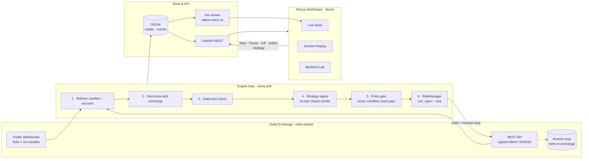

# TokenIQ: autonomous BTC trading bot

An algorithmic trading system on **Delta Exchange India testnet**. A Python FastAPI engine trades BTCUSD on its
own, behind a five-layer risk engine, and every entry carries its stop on the exchange. A Next.js dashboard shows
each decision live.

**Live dashboard:** https://tokeniq-hackathon-splashers-chi.vercel.app (backend on Render, Singapore)
· Built by **Team Splashers**: Aditya Doshi, Atharva Bhosale

```
backend/   FastAPI bot: Delta client, strategies, risk engine, execution loop, backtester, API
frontend/  Next.js dashboard: Live Desk, Session Replay, Backtest Lab, About
docs/      audit notes and screenshots
CLAUDE.md  full project context for developers and coding agents (architecture, logic, gotchas)
render.yaml  Render blueprint for the backend
```

## Architecture



The engine only acts on a newly **closed** candle. Paper mode (`DRY_RUN=true`, the default) runs the same path
without sending orders. The dashboard reads state and sends controls; it never places trades.

## Strategies

Every strategy implements one interface (`compute`, `signal`, `should_exit`, `get_checklist`) and can be
backtested. Only `live_enabled` strategies may trade, and you can switch between them from the dashboard (refused
while a position is open).

| Strategy                                       | Live | Rules                                                                                                                                                                                   | Evidence (real Delta data, 365 days)                                                    |
| ---------------------------------------------- | ---- | --------------------------------------------------------------------------------------------------------------------------------------------------------------------------------------- | --------------------------------------------------------------------------------------- |
| **`trend_regime`** (default)                   | ✅   | Long when EMA20 > EMA50, close > EMA20 and ADX ≥ 20 (short mirrored). Stand aside when ATR > 3× its 100-bar median. 3×ATR trailing stop on Delta; exit when the EMAs cross back.        | BTC 1h: about +0.7% for the year, about +1% (PF 1.04) out of sample. Modest and honest. |
| **`stoch_sma_66`** (Stochasticate Momentum 66) | ✅   | 66 SMA rising 10 bars + Stochastic %K (14, 2, 3) up through 20 on a green candle (short: falling SMA, %K down through 60, red candle). 4-bar swing stop, 1:2 target as a Delta bracket. | Made live by team decision. BTC 1h about −37%; positive only on ETH 4h.                 |
| `sma_cross_5_15`                               | ❌   | 5/15 SMA crossover, fixed 0.20% stop                                                                                                                                                    | Loses heavily out of sample (fees eat about half the risk, no regime filter)            |
| `scalping_strategy`                            | ❌   | Triple EMA + RSI + volume, fixed 0.20% stop                                                                                                                                             | Loses heavily out of sample                                                             |

**Cross-asset check** (trend_regime, 1h, default params): BTC +0.7%, ETH −29%, SOL +0.8%, XAUT −15% (6 months of
history). The **Backtest Lab** reruns everything per asset with a 70/30 in-sample / out-of-sample split.

On 1m every strategy loses about 3% a day after fees, so `PRESET=demo` (1m) is labelled "demo speed": it is
there so judges see trades within minutes, not as the edge.

## Risk engine (`backend/app/risk.py`)

1. **Risk 1% of equity per trade**: `size = floor(min(equity·1% / (stop_distance·contract_value), equity·leverage / (price·contract_value)))`
2. **5× leverage cap**
3. **Max 10 trades a day**, 15-minute cooldown after a loss
4. **−3% daily loss limit**: flatten and halt until the next UTC day
5. **Kill switch**: cancel all orders, reduce-only close, stays off until reset (survives restart)

## Backend highlights

- **Delta client** (`delta/client.py`): async REST, HMAC-SHA256 signing (`method + timestamp + path + query + body`).
  Delta signatures expire in 5s, so the client tracks the server clock offset and re-syncs on `request_expired`.
  Retries with exponential backoff and 429 handling via `X-RATE-LIMIT-RESET`.
- **Market WebSocket** (`delta/ws.py`): 35s heartbeat watchdog, reconnect backoff 1s → 30s.
- **Engine** (`engine.py`): reconciliation every tick (a stop that fired on Delta closes the trade in our log),
  restart recovery (adopts an open position and places a missing stop), circuit breaker (5 errors in a row → 60s
  pause), stale-data and empty-candle guards.
- **Backtester** (`backtest.py`): replays history through the same `Strategy` and `RiskManager`: signal on close,
  fill at the next open, stop checked before target, 0.053% taker fee per side (the real testnet fee).
  `fetch_history` pages past Delta's 2000-candle limit.
- **API** (`api/routes.py`): every input validated (400/409/422), exchange failures surfaced as 502. Backtests run
  in a worker thread, one at a time, and finished results are cached for 10 minutes, so the bot's loop, `/health`
  and `/ws` keep responding on a small Render instance.
- **Tests**: 40+ tests against a `FakeDelta` exchange (stop fills, restart recovery, kill switch, every strategy
  rule); no network.

## Quickstart

Requires [uv](https://docs.astral.sh/uv/) (installs Python 3.12) and Node 20+.

```bash
# backend
cd backend
cp .env.example .env        # testnet API key/secret from demo.delta.exchange
uv sync
uv run pytest               # no network
uv run uvicorn app.main:app --reload        # http://localhost:8000/docs

# frontend (second terminal)
cd frontend
cp .env.example .env.local  # NEXT_PUBLIC_API_URL=http://localhost:8000
npm install
npm run dev                 # http://localhost:3000
```

Useful scripts (run from `backend/`):

```bash
uv run python -m scripts.check_connection --order   # place + cancel a test order on testnet
uv run python -m scripts.test_bracket               # verify the exchange-side trailing stop
uv run python -m scripts.compare --resolution 1h --days 365
```

### Settings (`backend/.env`)

| Setting                      | Meaning                                                                                             |
| ---------------------------- | --------------------------------------------------------------------------------------------------- |
| `PRESET=validated`           | trend_regime on **1h**, the backtested setting                                                      |
| `PRESET=demo`                | trend_regime on **1m** with faster entries, so trades happen during a pitch (labelled "demo speed") |
| `DRY_RUN=true` (default)     | paper trading. Set `false` to send real orders to Delta **testnet**                                 |
| `AUTO_START=false` (default) | the bot trades only after Start on the dashboard                                                    |

Testnet keys only. Production Delta is used only for public candles in backtests.

## API

| Method | Path                                                                                   |                                                                              |
| ------ | -------------------------------------------------------------------------------------- | ---------------------------------------------------------------------------- |
| GET    | `/health`, `/status`, `/trades`, `/events`, `/api/strategies`, `/api/analytics/weekly` | state                                                                        |
| GET    | `/candles?resolution=1m\|5m\|15m\|1h`                                                  | real Delta candles plus strategy indicators                                  |
| POST   | `/bot/start`, `/bot/stop`, `/bot/kill`, `/bot/reset-kill`                              | controls                                                                     |
| POST   | `/bot/select-strategy`                                                                 | switch the live strategy (409 with a position open, 400 if not live-enabled) |
| POST   | `/backtest` · `/backtest/compare` · `/replay`                                          | single backtest · live-strategy in/out-of-sample comparison · session replay |
| WS     | `/ws`                                                                                  | live events and a status snapshot every 2s                                   |

Interactive docs at `/docs`.

## Deployment

- **Backend**: Render blueprint (`render.yaml`), Singapore region, `PRESET=validated`, `DRY_RUN=true` until
  verified. The free plan sleeps without traffic and wipes the disk on restart; open positions are still adopted
  from Delta on boot, and their stops live on the exchange.
- **Frontend**: Vercel, with `NEXT_PUBLIC_API_URL` pointing at the Render service. CORS allows the production
  domain and this project's preview URLs.

## Checks

```bash
cd backend && uv run pytest
cd frontend && npx tsc --noEmit && npm run lint && npm run build
```

## Git branching

- main -> develop -> feat | fix | chore | refactor -> back to develop & prod(main) merge
